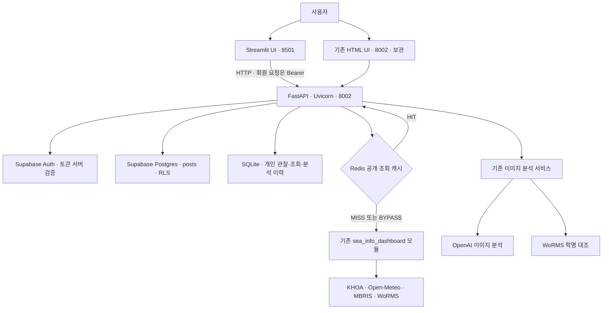

# AI-marine info 기술 스택 현황

> 작성일: 2026-11-06 (한국 시간)
>
> 기준: `C:\KBR\ai_marine_info`와 연결된 `C:\KBR\sea_info_dashboard`의 실제 코드,
> 의존성 파일 및 프로젝트 가상환경의 설치 버전.
> 여기서 ‘현재 버전’은 프로젝트 현황이며 각 제품의 최신 출시 버전을 뜻하지 않습니다.

## 1. 프로젝트 요약

AI-marine info는 전국 해안 지역의 물때·실측 수온·해양 예보, 해양생물 검색,
회원 게시판, 사진 분석과 개인 기록을 제공하는 학습용 해양 정보 서비스입니다.

**현재 구성:**

**Python + Streamlit + FastAPI + Supabase Auth/Postgres + SQLite + Redis + 외부 해양·생물 API + OpenAI API**

현재 메인은 해양 정보 대시보드입니다. 사진 분석 중심 메인으로의 전환, YOLO 적용,
Gemini 연결, 동의 기반 사진 재사용과 뉴스 수집은 계획 단계이며 현재 구현으로 표시하지 않습니다.

이 문서는 소스 구현 여부를 정리한 것으로, 운영 배포나 실제 외부 서비스의 정상 동작을
모두 보증하는 검증 보고서는 아닙니다. 이번 문서 작성 중 서버·API·테스트를 재실행하지 않았습니다.

## 2. 전체 구조



- Streamlit과 FastAPI는 각각 실행하는 프로세스입니다.
- Streamlit은 HTTP로 FastAPI를 호출하며 DB에 직접 접근하지 않습니다.
- Redis는 외부 API를 직접 호출하지 않습니다. FastAPI가 캐시 조회와 원본 호출을 조정합니다.
- 사진 분석 내부의 WoRMS 학명 대조는 별도 기존 서비스 경로이며, 현재 일반 도감 API의 Redis 캐시를 그대로 경유하지는 않습니다.
- 포트는 로컬 실행 기준입니다. 실제 무료 배포 구성이 확정·검증됐다는 뜻은 아닙니다.

## 3. 구현된 핵심 기술

| 영역 | 기술 | 역할 | 주요 근거 파일 |
|---|---|---|---|
| 개발 언어 | Python | 서버·화면·외부 API·저장 처리 | 프로젝트 Python 소스 |
| 주 UI | Streamlit | 다중 페이지, 좌측 메뉴, 폼·업로드·표·차트 | [streamlit_app.py](../streamlit_app.py) |
| UI 상태 | `st.session_state` | 사용자별 토큰·선택 조건·조회 결과·화면 모드 | [streamlit_app.py](../streamlit_app.py) |
| UI 스타일 | CSS·정적 HTML | 딥블루·청록 테마, 제목·카드·간격 | [theme.css](../ui/theme.css) |
| 표·차트 데이터 | pandas | 예보와 조위 표시용 데이터 구성 | [streamlit_app.py](../streamlit_app.py) |
| 차트 | Streamlit 내장 차트·Altair 기반 | 시간별 파고·수온 선 그래프, 조위 막대 비교 | [streamlit_app.py](../streamlit_app.py) |
| 백엔드 | FastAPI | 인증·게시판·해양 정보·생물·사진·개인 기록 API | [main.py](../app/main.py) |
| 서버 | Uvicorn | ASGI 애플리케이션 실행 | [requirements.txt](../requirements.txt) |
| 데이터 검증 | Pydantic v2·EmailStr·SecretStr | 입력·응답 스키마, 이메일·비밀번호·길이·형식 검증 | [schemas.py](../app/schemas.py) |
| 서버 간 통신 | HTTPX | Streamlit→FastAPI와 외부 데이터 조회, 타임아웃 | [api.py](../ui/api.py), 기존 서비스 |
| 인증 | Supabase Auth | 가입·로그인·로그아웃·메일 OTP 확인·비밀번호 재설정 | [auth.py](../app/auth.py) |
| 게시판 저장 | Supabase PostgreSQL | 회원 게시글 장기 저장 | [posts.py](../app/posts.py) |
| DB 권한 | PostgreSQL RLS·열 권한·트리거 | 회원 조회, 작성자 검증, 본인 수정·삭제 제한 | [schema.sql](../supabase/schema.sql) |
| DB 통신 | Supabase SDK·PostgREST | 사용자 access token을 실어 RLS 적용 | [posts.py](../app/posts.py) |
| 개인 기록 | SQLite·표준 `sqlite3` | 관찰 기록, 조회 이력, 분석용 사진 BLOB 저장 | [storage.py](../app/storage.py) |
| 단기 캐시 | Redis·redis-py | 공개 해양·생물 조회 결과 재사용 | [cache.py](../app/cache.py) |
| 이미지 입력 | python-multipart | 파일·동의 폼 수신 | [marine.py](../app/marine.py) |
| 이미지 처리 | Pillow | 형식·용량·픽셀 검사, 방향 보정·축소·메타데이터 제거용 재인코딩 | 기존 `image_service.py` |
| 이미지 AI | OpenAI API·Python SDK | 사진 속 생물 후보·특징·한계의 구조화 응답 | 기존 `image_service.py` |
| 환경 설정 | python-dotenv·환경변수 | 접속 정보 로딩·시작 시 설정 검사 | [config.py](../app/config.py) |
| 기존 기능 통합 | Python AST·모듈 로더 | 원본 서비스 파일을 복사하지 않고 연결 | [legacy.py](../app/legacy.py) |

### 보관 중인 기존 프론트엔드

| 기술 | 현재 역할 |
|---|---|
| Jinja2 | FastAPI에서 기존 HTML 페이지 생성 |
| HTML·CSS·바닐라 JavaScript | 기존 웹 UI와 API 호출 |
| 브라우저 `sessionStorage` | 기존 HTML UI의 access token 보관 |

Streamlit UI는 토큰을 사용자별 서버 세션 메모리에 보관합니다. 두 UI의 토큰 저장 방식은 다릅니다.
기존 템플릿과 정적 파일은 [app/templates](../app/templates), [app/static](../app/static)에 남아 있습니다.

## 4. 현재 설치 버전과 의존성 선언

아래 설치 버전은 프로젝트 `.venv`에서 확인했습니다.

| 기술·패키지 | 로컬 설치 버전 | 의존성 선언 |
|---|---|---|
| Python | 3.12.14 | 런타임 버전 확인값 |
| FastAPI | 0.162.0 | `fastapi==0.162.0` |
| Uvicorn | 0.54.0 | `uvicorn==0.54.0` |
| Pydantic | 2.14.2 | `pydantic[email]==2.14.2` |
| HTTPX | 0.28.1 | `httpx==0.28.1` |
| Supabase SDK | 2.33.0 | `supabase==2.33.0` |
| python-dotenv | 1.2.4 | `python-dotenv==1.2.4` |
| Jinja2 | 3.1.6 | `Jinja2==3.1.6` |
| python-multipart | 0.0.32 | `python-multipart==0.0.32` |
| Pillow | 12.3.0 | `Pillow==12.3.0` |
| OpenAI SDK | 2.54.0 | `openai==2.54.0` |
| redis-py | 6.4.0 | `redis>=5.2,<7` |
| Streamlit | 1.66.1 | `streamlit>=1.66.1,<2` |
| pandas | 3.1.0 | UI가 직접 import, 개별 버전 고정 없음 |
| Altair | 6.3.0 | Streamlit 의존성으로 설치, 개별 버전 고정 없음 |
| NumPy | 2.5.4 | 관련 의존성으로 설치, 개별 버전 고정 없음 |
| pytest | 9.2.0 | `pytest==9.2.0` |
| fakeredis | 2.40.0 | `fakeredis==2.40.0` |

의존성 파일:

- [requirements.txt](../requirements.txt): 백엔드·기존 UI·이미지 분석·캐시.
- [requirements-ui.txt](../requirements-ui.txt): 기본 의존성 + Streamlit.
- [requirements-dev.txt](../requirements-dev.txt): 기본 의존성 + pytest·fakeredis.

Redis 서버·PostgreSQL 서버 버전은 위 Python 패키지 버전과 다릅니다.
Compose의 Redis 이미지 지정은 `redis:7.4-alpine`이며 실제 실행 서버 버전을 이번에 확인한 것은 아닙니다.
Supabase Postgres 서버 버전 역시 이번 문서에서는 확인하지 않았습니다.

## 5. 외부 데이터·AI 연동

| 출처 | 현재 연결 내용 | 조건·한계 |
|---|---|---|
| 국립해양조사원 KHOA | 물때·관측소 실측 정보 | API 키·활용 승인·관측소별 제공 범위에 의존 |
| Open-Meteo Marine | 대표 좌표의 파고·해수면 온도 예보 | 관측소 실측과 구분하여 표시 |
| MBRIS | 국명 기반 해양생물 검색 | API 키·활용 승인 필요 |
| WoRMS | 학명·일반명 검색, 분류·일반명·분포 상세 | 분류 정보이며 사진 식별 정답·식용 안전성 판정이 아님 |
| OpenAI | 사진 분석 후보와 특징·판별 한계 | `OPENAI_API_KEY`, `OPENAI_MODEL` 설정 필요 |

현재 사진 분석은 검증·전처리 → OpenAI 구조화 응답 → 후보 학명의 WoRMS 대조 → 개인 이력 저장 순서입니다.
연동 코드가 있다는 사실과 실제 계정의 인증·사용량·자료 수신 성공은 구분해야 합니다.

## 6. 저장소별 역할

| 저장소 | 실제 저장 대상 | 유의점 |
|---|---|---|
| Supabase Auth | 회원 인증 정보, 이름 메타데이터 | 비밀번호를 앱 DB에 별도 저장하지 않음 |
| Supabase Postgres | `posts` 게시글 | RLS·트리거 SQL 제공, 실제 프로젝트 적용 여부는 별도 확인 |
| SQLite | `records`, `history`, 분석 사진 BLOB | 현재 개인 자료는 Supabase Storage가 아닌 서버 로컬 저장 |
| Redis | 공개 해양·생물 조회 JSON | 장기 원본 저장소가 아님 |
| JSON 파일 | 지역·관측소 카탈로그와 출처 | [regions.json](../data/regions.json), [station_sources.json](../data/station_sources.json) |
| Streamlit 세션 | 토큰·지역 조건·화면 상태·일시 결과 | 브라우저 연결 초기화·서버 재시작 시 사라질 수 있음 |

## 7. Redis의 실제 적용 범위

| 캐시 종류 | 키 조건 | TTL |
|---|---|---:|
| 해양 예보 | 위도·경도·날짜 | 600초 |
| 물때 | 관측소·날짜 | 3,600초 |
| 실측 | 관측소·날짜 | 120초 |
| MBRIS 검색 | 검색어·페이지 | 3,600초 |
| WoRMS 검색 | 검색어 | 3,600초 |
| WoRMS 상세 | AphiaID | 86,400초 |

- Cache-aside: Redis 우선 조회, 없으면 외부 조회 후 저장.
- 항목당 직렬화 값 64 KiB 이하, 만료 시간과 함께 저장.
- 오류·미설정 결과 저장 제외, Redis 장애 후 일정 시간 우회.
- 연결 최대 12개, 연결·명령 타임아웃 각 0.3초, 프로세스 내 고정 32개 잠금.
- 개인 `history_id`를 붙이기 전 공개 데이터만 저장.
- 응답 헤더 `X-Marine-Cache`: HIT / MISS / BYPASS.
- 사진·토큰·개인 이력·게시글은 공용 캐시 대상이 아님.
- Redis 기반 세션·분산 요청 제한·전체 로그 집계는 아직 구현하지 않음.

[compose.redis.yml](../compose.redis.yml)은 Redis 전용 실행 설정입니다.

| 항목 | 설정 |
|---|---|
| 데이터 메모리 기준 | `maxmemory 64mb` |
| 제거 정책 | `allkeys-lfu` |
| 컨테이너 메모리 상한 | 192 MiB |
| 노출 주소 | 로컬 `127.0.0.1:6379` |
| 디스크 영속화 | RDB·AOF 비활성 |

이는 해당 Compose로 실행할 때의 설정이며 기존 Redis 서버에 자동 적용되는 정책은 아닙니다.
또한 `maxmemory`는 프로세스 전체 RSS의 정확한 상한이 아닙니다.
전체 웹앱 Dockerfile·통합 Compose까지 구현된 상태는 아닙니다.

## 8. 인증·보안 구현

| 항목 | 현재 구현 |
|---|---|
| 토큰 검증 | HTTPBearer + Supabase `auth.get_user(token)` |
| 게시판 권한 | 전 API 회원 필수, 본인 수정·삭제, 타인 조작 404 |
| DB 접근 | publishable 키와 사용자 토큰 사용, 서비스 롤 키 미사용 |
| 인증 SDK | 요청별 클라이언트, 세션 영속화·자동 갱신 비활성, 타임아웃 |
| 검증 오류 | RequestValidationError의 입력 원문 제외 |
| 인증 요청 제한 | 프로세스 메모리의 최근 요청 기록, Redis 기반 아님 |
| 업로드 제한 | 사진 최대 10 MiB·2천만 픽셀, 정적 JPEG/PNG/WEBP |
| 응답 헤더 | no-store·콘텐츠 형식 보호·Referrer 정책 등 |
| 입력 출력 | Streamlit 텍스트·JSON 표시, 기존 JS의 텍스트 DOM 생성 |
| 비밀 설정 | `.env`·Streamlit secrets·개인 자료 경로를 `.gitignore`에서 제외 |

주의: FastAPI의 보안 헤더와 기존 HTML용 CSP가 Streamlit 서버에도 그대로 적용되는 것은 아닙니다.
Streamlit은 별도 프로세스의 기본 보안 설정과 `.streamlit/config.toml`을 사용합니다.

## 9. 테스트·개발 지원

| 기술 | 역할 |
|---|---|
| pytest·unittest.mock | 기능·입력·실패·권한·설정 검증 |
| FastAPI TestClient | 실제 포트를 열지 않는 API 테스트 |
| HTTPX 모의 응답 | 실제 외부 계정·API 호출 없이 SDK 흐름 확인 |
| fakeredis | 캐시 적중·만료·삭제·장애·이력 분리 테스트 |
| Streamlit AppTest | 위젯 실행, 화면·작성 흐름 검증 |
| Node.js 내장 test·vm | 보관 중인 기존 JavaScript 화면 로직 테스트 코드 |
| Python 백업 스크립트·ZIP·SHA-256 | 소스 백업 및 무결성 확인에 활용 |

직전 UI 개편 작업에서 보고된 Python 테스트 결과는 **65개 통과**입니다.
이번 문서 작성에서는 테스트를 다시 실행하지 않았으며 Node 테스트도 새로 실행하지 않았습니다.
모의 테스트 통과를 실제 Supabase·메일·AI 과금 호출·운영 배포 성공으로 해석하면 안 됩니다.

## 10. 논의했지만 아직 미구현인 항목

| 기술·기능 | 현재 상태 |
|---|---|
| YOLO·Ultralytics·ONNX 추론 | 모델 조사·계획 단계. 실제 추론 연결 없음 |
| Gemini API·google-genai 연동 | 키 설정 방법 안내 단계. 사진 서비스는 아직 OpenAI |
| SmolVLM·LFM·BioCLIP | 후보 조사 단계. 로컬 모델 실행 연결 없음 |
| 사진 분석 중심 홈 | 계획 단계. 현재 홈은 해양 정보 대시보드 |
| 선택 동의 기반 사진 재사용 DB | 계획 단계. 현재 분석 동의와 SQLite 이력 저장과는 다른 기능 |
| 동일 사진 결과 재사용 | 이미지 해시 생성은 있으나 재사용 조회 흐름 없음 |
| 유사 사진 검색·pgvector | 미구현 |
| Supabase Storage 사진 보관 | 미구현. 현재 사진은 SQLite BLOB |
| 동의 철회·재사용 검색 제외 | 새 동의 정책과 연계한 구현 필요 |
| 뉴스 API·RSS·칼럼 크롤링 | 검토 단계. 수집기·스케줄러·뉴스 API 없음 |
| 전체 운영 로그 대시보드 | 미구현. 도움말에 세션의 최근 캐시 상태만 표시 |
| Redis 분산 요청 제한·단기 인증 세션 | 미구현 |
| 지도 기반 지역 선택 | 기획 단계 |
| 제철 수산물·영양·금어기 캘린더 | 기획 단계 |
| 전체 서비스 무료 배포 | 서비스 조건 검토 단계. 최신 구성의 운영 배포 검증 없음 |

## 11. 실행·설정 참고

CMD 창 1 — FastAPI:

```bat
cd /d C:\KBR\ai_marine_info
.venv\Scripts\python.exe -m uvicorn app.main:app --host 127.0.0.1 --port 8002
```

CMD 창 2 — Streamlit:

```bat
cd /d C:\KBR\ai_marine_info
.venv\Scripts\python.exe -m streamlit run streamlit_app.py --server.port 8501
```

프로젝트 전용 가상환경·의존성·`.env` 설정이 준비되어 있어야 합니다.
주요 환경변수는 `SUPABASE_URL`, `SUPABASE_PUBLISHABLE_KEY`, `APP_ORIGIN`,
`SUPABASE_RESET_REDIRECT_URL`, `SUPABASE_SIGNUP_REDIRECT_URL`, `SEA_INFO_SOURCE`,
`REDIS_URL`, `MARINE_API_BASE_URL`, KHOA 관련 키, `MBRIS_API_KEY`,
`OPENAI_API_KEY`, `OPENAI_MODEL`입니다. 실제 값은 이 문서에 포함하지 않습니다.

현재 기본 원본 경로는 프로젝트의 형제 폴더 `../sea_info_dashboard`입니다.
다른 저장소 구조로 배포할 때는 `SEA_INFO_SOURCE`와 패키징을 맞춰야 합니다.

관련 문서:

- [README](../README.md)
- [Streamlit·Redis 설치 및 동작](STREAMLIT_REDIS.md)
- [화면 재배치·백업·복원](LAYOUT_REDESIGN.md)
- [코드 설명](CODE_GUIDE.md)

## 12. 발표·공유용 한 문장

> Streamlit과 FastAPI를 기반으로, Supabase 인증·게시판 DB, SQLite 개인 기록,
> Redis 공개 데이터 캐시를 결합하고 해양·생물 정보 API와 OpenAI 사진 분석을 연결한 서비스입니다.
> YOLO·Gemini 전환, 사진 재사용 검색과 뉴스 수집은 후속 확장 계획입니다.
